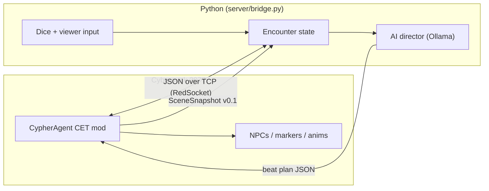

# Architecture

Cypher Vision treats Cyberpunk 2077 as a **rendering stage** for scripted encounters. The game engine does not run the story logic — Python does. The LLM writes prose and beat plans; CET executes visual verbs at predefined markers.

---

## Three layers

| Layer | Runs in | Responsibility |
|-------|---------|----------------|
| **Encounter state** | Python | Authoritative HP, inventory, dice results, viewer votes, scene phase |
| **AI director** | Python + Ollama | Narration, dialogue, consequence text, ordered beat plans |
| **Puppet layer** | CET Lua | Spawn NPCs, teleport to markers, play animations, subtitles, attitude |

The LLM never issues raw coordinates or engine calls. It outputs **scene beats** that map to a fixed verb vocabulary. CET translates verbs into verified CET APIs.

---

## Data flow



**Tick model (encounter mode):** Turn-based, not 200ms combat AI. Snapshots still poll at 5 Hz for debugging and connection health, but the director only acts on **phase transitions** (vote closed, dice resolved, beat complete).

**Today:** `server/bridge.py` handles TCP, ACKs, and imperative bridge commands (`amm_spawn_npc`, etc.). Encounter state and the director layer will extend this process in Phase 3+.

---

## What each side sends

### Game → Python (SceneSnapshot v0.1)

Implemented. See [bridge/bridge-protocol-v0.1.md](bridge/bridge-protocol-v0.1.md) for the full envelope. Grows to include encounter context:

```json
{
  "schema_version": "scene_snapshot.v0.1",
  "tick_id": 42,
  "player": { "position": {}, "facing": {}, "is_in_combat": false },
  "encounter_id": "kabuki_alley_01",
  "markers": { "player_spot": {}, "npc_a": {}, "camera_wide": {} },
  "events": []
}
```

Markers are **authored per encounter** (hand-placed coordinates), not extracted navmesh.

### Python → Game (beat plan)

Target shape for Phase 4+. An ordered list of visual verbs:

```json
{
  "beat_id": "negotiation_fail",
  "lines": [
    {"speaker": "fixer", "text": "Wrong answer, choom."}
  ],
  "verbs": [
    {"verb": "set_attitude", "target": "npc_fixer", "args": {"group": "hostile"}},
    {"verb": "play_animation", "target": "npc_fixer", "args": {"anim": "draw_weapon"}},
    {"verb": "show_subtitle", "args": {"text": "Negotiation failed.", "duration": 3}}
  ]
}
```

**Interim (Milestone 0.5):** Python sends `BridgeCommand` envelopes (`amm_spawn_npc`, `amm_set_appearance`, `amm_despawn_npc`) via `bridge.py` interactive mode or scripted sends. These are the low-level building blocks beat plans will wrap.

CET executes verbs sequentially with optional delays. Failed verbs log and skip — they do not crash the mod.

---

## What we deliberately do NOT build

| Approach | Why not (for now) |
|----------|-------------------|
| LLM drives real-time combat | Turn latency, unreliable physics, CET has no `Navigate()` |
| Navmesh / semantic world graph | High effort; markers cover encounter staging |
| DMA / memory reading | Banned; CET APIs are sufficient |
| WebSocket transport | Banned; use RedSocket TCP with `\r\n` delimiter |
| Autonomous 24/7 agent simulation | v2+ vision; not the demo path |

---

## Component naming (informal)

| Name | Meaning | Status |
|------|---------|--------|
| **CypherBus** | CET ↔ Python TCP bridge (snapshots + commands) | **Partial** — `server/bridge.py` + RedSocket in `init.lua` |
| **CypherLedger** | Persistent encounter/campaign state (SQLite later) | Planned (Phase 3+) |
| **CypherBody** | CET puppet executor (verb → Lua API) | **Partial** — AMM spawn/despawn/appearance; beat executor TBD |

---

## Hard limits (CET reality)

**Works reliably:** player position, combat flags, teleport, AMM NPC spawn, attitude groups, status effects, `Observe()` hooks, workspot animations (with research).

**Hard or fragile:** pathfinding to arbitrary points, forcing specific combat maneuvers, replacing vanilla AI, scanning all nearby entities cheaply.

Design encounters around **teleport-to-marker + animation**, not "walk naturally to cover."
